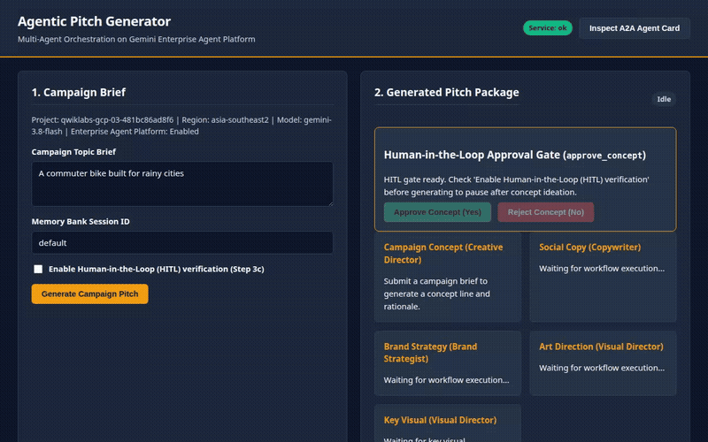

# Agentic Pitch Generator

An enterprise multi-agent campaign generation platform powered by Google Gemini, Imagen 3, Agent-to-Agent (A2A) protocol, BigQuery analytics, and Vertex AI.



---

## Overview

The **Agentic Pitch Generator** coordinates specialized AI agents in a structured, observable workflow to transform a raw creative brief into a production-ready marketing pitch package, complete with concept ideation, brand strategy, channel-specific copy, photographic art direction, and generated key visuals.

---

## Architecture & Specialist Team

```
                                  +-------------------+
                                  |   User Brief      |
                                  +---------+---------+
                                            |
                                  [ PII Scrubbing Entrypoint ]
                                            |
                                            v
                                +-----------------------+
                                |   Creative Director   |
                                +-----------+-----------+
                                            |
                                            v
                            [ Human-in-the-Loop (HITL) Gate ]
                                            | (Approved)
                                            v
                                +-----------------------+
                                |   Brand Strategist    |
                                +-----------+-----------+
                                            |
                         +------------------+------------------+
                         |                                     |
                         v                                     v
                 +---------------+                 +-----------------------+
                 |  Copywriter   |                 | Remote Visual Director|
                 +-------+-------+                 | (A2A Microservice +   |
                         |                         |  Brand Guidelines)    |
                         |                         +-----------+-----------+
                         |                                     |
                         +------------------+------------------+
                                            |
                                            v
                                    +---------------+
                                    | Assemble Node |
                                    +-------+-------+
                                            |
                                            v
                                    +---------------+
                                    | Package Node  |
                                    +---------------+
```

### Specialist Agents
* **Creative Director** (`gemini-3.8-flash`): Ideates core campaign concepts, target audiences, and creative hooks.
* **Human-in-the-Loop Gate** (`user_approval`): Pauses execution after concept ideation for human review (yes/no), resuming downstream execution only on explicit approval and failing closed on rejection.
* **Brand Strategist** (`gemini-3.8-flash`): Establishes brand positioning, tone pillars, and multi-channel marketing strategies.
* **Copywriter** (`gemini-3.8-flash`): Crafts headlines, narrative body copy, and social copy tailored to audience personas.
* **Visual Director** (`RemoteA2aAgent` via A2A v0.3 protocol): Enforces authoritative house style guides via the `brand-guidelines` skill and generates photorealistic key visual art direction and imagery.
* **Assembler & Packager**: Normalizes and structures all specialist outputs into a unified `PitchPackage`.

---

## Google Cloud Services & Integrations

The codebase connects directly to the following Google Cloud and enterprise services:

* **Vertex AI Gemini (`gemini-3.8-flash`, `gemini-3.8-pro`)**: Structured JSON multi-agent reasoning, specialized role prompts, and loop-guarded execution.
* **Imagen 3 (`imagen-3.0-generate-002`)**: High-resolution (1024x1024) photographic key visual asset generation steered by loaded brand guideline constraints.
* **Google Cloud Storage (GCS)**: Persistent storage for generated image artifacts (`gs://<bucket>/artifacts/<session_id>/key_visual.png`).
* **Google BigQuery Telemetry & Drift Remediation**:
  * `BigQueryAnalyticsService`: Structured streaming telemetry recording specialist latencies, token counts, and session outcomes into `bwg.agent_events`.
  * Brand Drift Scoring & Auto-Tuning: AI scoring of visual prompts and closed-loop prompt tuning to eliminate off-brand terms (e.g., neon, harsh ring lights, watermarks).
* **Agent-to-Agent (A2A) Protocol v0.3**: Exposes the Visual Director as an independent microservice with discovery metadata published at `/.well-known/agent-card.json`.

---

## Security, Governance & Safety

* **PreToolUse Lifecycle Hooks**: Intercepts tool execution to enforce strict allowlists (`load_skill`, `generate_key_visual`), blocks forbidden overrides (`bypass_safety`, `override_brand_guidelines`), blocks path traversal sequences, and rejects prompt injection patterns.
* **PII Scrubbing**: In-memory redaction for API keys, email addresses, credit cards, Social Security numbers, and phone numbers across raw text and nested dictionaries without mutating input data.
* **Human-in-the-Loop (HITL) Authorizations**: Prevents unnecessary downstream token consumption on unapproved creative concepts.

---

## Tokenomics & Context Optimizations

* **Memory Compression (`compress_memory`)**: Automatically condenses multi-turn dialog histories prior to the last two turns into a compact system summary.
* **Sliding-Window History Pruning (`prune_history`)**: Enforces hard token and turn limits with deterministic single-turn truncation handling.
* **SHA-256 Prompt Caching (`PromptCacheManager`)**: Hashes invariant static prefixes (e.g. house style guidelines) with TTL validation to optimize prompt token reuse.
* **Model Tier Routing (`select_model_strategy`)**: Dynamically routes workloads across 5 tiers (`flash`, `pro`, `low`, `high`, `local`).

### Empirical Tokenomics Benchmark

Evaluated on a 10-turn campaign ideation session for *"Flying skateboards for cats"* with static house brand guidelines:

| Optimization Stage | Turns | Token Count | Efficiency / Behavior |
| :--- | :---: | :---: | :--- |
| **Raw Unoptimized Session** | 10 turns | **213 tokens** | Baseline dialog history |
| **Static Prefix (`brand-guidelines`)** | 1 skill | **204 tokens** | House style constraints |
| **Total Baseline Input** | 11 items | **417 tokens** | Unoptimized prompt payload |
| **After Memory Compression** | 3 turns | **155 tokens** | 1 system summary + last 2 turns verbatim |
| **After Sliding-Window Pruning** | 3 turns | **155 tokens** | Constrained to `max_turns=4` & budget `max_tokens=250` |
| **Total Turn Savings** | — | **58 tokens saved** | **27.2% reduction on conversation history** |

#### Prompt Cache Lifecycle (SHA-256 Key: `6083123a...0c79`)
* **Pass 1 (Cold Cache)**: `cache_hit: False` | `saved_tokens: 0` (Computes and stores SHA-256 digest)
* **Pass 2 (Warm Cache)**: `cache_hit: True` | `saved_tokens: 204 tokens` (Direct cache hit, 100% prefix reuse)

#### Model Tier Strategy
* **Selected Tier**: `flash` (`gemini-3.8-flash`) — Target: `low_latency_throughput`, Cost: `low`, Thinking Budget: `0`

---

## Local Setup & Execution

### Prerequisites

* Python 3.10+
* Google Cloud SDK (`gcloud`) authenticated with a project with Vertex AI, Cloud Storage, and BigQuery APIs enabled.

### Environment Configuration

Create a `.env` file in the project root:

```bash
PROJECT_ID="your-gcp-project-id"
REGION="us-central1"
BUCKET_NAME="your-gcs-bucket-name"
BIGQUERY_DATASET="bwg"
BIGQUERY_TABLE="agent_events"
GEMINI_MODEL="gemini-3.8-flash"
IMAGEN_MODEL="imagen-3.0-generate-002"
```

### Starting the Local Application

Start both the Pitch Generator web server and Visual Director A2A service:

```bash
bash .agents/skills/start-frontend/scripts/start_server.sh --with-visual-director
```

### Running CLI Tests

To execute a campaign brief directly via the CLI:

```bash
python3 call_agent.py "Flying skateboards for cats"
```

To run offline tests:

```bash
python3 -m unittest discover tests
```
